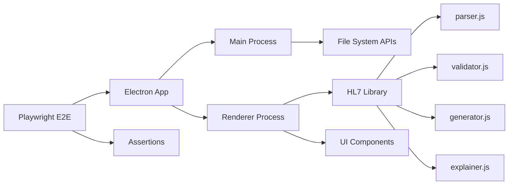

# Requirements

### Overview & Goals

Add comprehensive E2E test coverage for all user-visible features of the HL7Tool Electron desktop application using **Playwright's Electron API**, and create a **TEST_PLAN.md** document describing the test strategy.

### Current State

- **121 unit tests** already exist and pass (Node.js built-in test runner)
- Unit tests cover: parser, validator, generator, explainer, bulk generation, file I/O, and golden tests
- **No E2E (UI) tests** exist yet
- **No test documentation** exists

### Test Scope — All User-Visible Features

The user wants E2E tests covering all functions visible to the user:

1. **Message Validation** — Paste HL7 messages, verify validation results (errors, warnings, info)
2. **Message Generation** — Generate messages with different types, versions, settings
3. **Message Explanation** — Verify the Explain tab shows field names, values, narratives
4. **Bulk Generation** — Generate multiple messages, verify results table
5. **File Operations** — Save/open HL7 files with different encodings and line endings
6. **Clipboard Operations** — Copy to clipboard functionality
7. **UI Navigation** — Tab switching, menu interactions
8. **Error Handling** — Invalid input, empty messages, malformed HL7
9. **Settings** — Line ending, encoding, separator configuration
10. **Welcome Screen** — Initial state and navigation

### Playwright Approach

**Electron Playwright** — Use `@playwright/test` electron API to test the actual Electron app window directly. This provides:
- Real Electron window testing (not browser emulation)
- Access to Electron-specific APIs (file dialogs, clipboard, etc.)
- Native dialog handling for save/open operations
- True E2E coverage of the desktop experience

### Deliverables

1. **TEST_PLAN.md** — Test strategy document covering:
   - Test levels (unit, integration, E2E)
   - What each level covers
   - How to run tests
   - Test coverage matrix

2. **Playwright E2E test suite** — covering all user-visible features:
   - `tests/e2e/validation.spec.js` — validation scenarios
   - `tests/e2e/generation.spec.js` — generation scenarios
   - `tests/e2e/explanation.spec.js` — explanation scenarios
   - `tests/e2e/bulk-generation.spec.js` — bulk generation
   - `tests/e2e/file-operations.spec.js` — file save/open
   - `tests/e2e/clipboard.spec.js` — clipboard operations
   - `tests/e2e/ui-navigation.spec.js` — navigation and menus
   - `tests/e2e/error-handling.spec.js` — error scenarios
   - `tests/e2e/settings.spec.js` — settings configuration

3. **Configuration files**:
   - `playwright.config.js` — Playwright configuration
   - `tests/e2e/helpers.js` — shared test helpers
   - `tests/e2e/fixtures.js` — Playwright fixtures for Electron

4. **package.json scripts**:
   - `test:e2e` — run E2E tests
   - `test:all` — run all tests (unit + E2E)

# Technical Design

### Current Implementation

**Project structure:**
```
HL7Tool/
├── main.js              # Electron main process
├── preload.js           # Preload script (IPC bridge)
├── renderer.js          # Renderer process (UI logic)
├── index.html           # Main UI HTML
├── styles.css           # Styles
├── src/hl7/             # HL7 core library
│   ├── parser.js        # HL7 message parser
│   ├── validator.js     # HL7 message validator
│   ├── generator.js     # HL7 message generator
│   ├── explainer.js     # HL7 field explainer
│   └── ...
├── test/                # Existing unit tests (121 tests)
│   ├── parser.test.js
│   ├── validator.test.js
│   ├── generator.test.js
│   ├── explainer.test.js
│   ├── bulk.test.js
│   ├── files.test.js
│   └── golden.test.js
└── package.json
```

**Key patterns:**
- Electron app with IPC communication (main ↔ renderer via `preload.js`)
- Renderer uses DOM manipulation (no framework)
- HL7 library is framework-agnostic (pure JS)
- Existing tests use Node.js built-in test runner

### Playwright Electron Setup

**Configuration** (`playwright.config.js`):
```javascript
module.exports = {
  testDir: './tests/e2e',
  use: {
    actionTimeout: 5000,
    timeout: 30000,
  },
  projects: [
    {
      name: 'electron',
      use: { electron: true },
    },
  ],
};
```

**Fixture** (`tests/e2e/fixtures.js`):
```javascript
const { test } = require('@playwright/test');

const electronTest = test.extend({
  app: async ({}, use) => {
    const app = await electron.launch({
      args: [path.join(process.cwd(), 'main.js')],
    });
    await use(app);
    await app.close();
  },
});

export { electronTest };
```

### Test Organization

Each test file follows a consistent pattern:
1. **Launch** the Electron app using fixture
2. **Wait** for the window to be ready
3. **Interact** with the UI (click, type, select)
4. **Assert** on UI state (text content, element visibility, etc.)
5. **Cleanup** (handled by fixture teardown)

### Key Test Helpers

```javascript
// tests/e2e/helpers.js
const HL7_MESSAGES = {
  ADT_A01: 'MSH|^~\\&|...', // Valid ADT^A01 message
  ORU_R01: 'MSH|^~\\&|...', // Valid ORU^R01 message
  INVALID: 'This is not HL7', // Invalid message
  EMPTY: '', // Empty string
};

async function pasteMessage(page, message) {
  await page.click('#messageInput');
  await page.fill('#messageInput', message);
}

async function clickTab(page, tabName) {
  await page.click(`[data-tab="${tabName}"]`);
}

async function getValidationResults(page) {
  return page.locator('#validationResults').textContent();
}
```

### Architecture Diagram



### Risks & Mitigations

1. **Electron launch timing** — Add explicit waits for window readiness
2. **File dialog handling** — Use Playwright's dialog interception for save/open
3. **Clipboard access** — Grant clipboard permissions in test setup
4. **Cross-platform paths** — Use `path.join()` for all file paths
5. **Flaky selectors** — Use data-testid attributes where available, fallback to IDs/classes

# Testing

### Validation Approach

After implementing the E2E test suite, I'll validate by:
1. Running the full E2E test suite with `npm run test:e2e`
2. Verifying all tests pass on the current Electron app
3. Running the combined test suite with `npm run test:all`
4. Checking that existing unit tests still pass (121 tests)

### Key Scenarios

**Validation Tests:**
- Paste valid ADT^A01 message → validation passes with no errors
- Paste invalid message → validation shows errors
- Paste message with warnings → validation shows warnings
- Empty message → validation shows appropriate message

**Generation Tests:**
- Generate ADT^A01 with defaults → message appears in output
- Generate with custom settings → message reflects settings
- Generate different message types → correct structure
- Generate with different HL7 versions → version-specific fields

**Explanation Tests:**
- Explain valid message → field names and values shown
- Navigate through segments → correct explanations
- Explain generated message → matches generation settings

**Bulk Generation Tests:**
- Generate 10 messages → all appear in results table
- Verify message count → correct count displayed
- Download bulk → file download triggered

**File Operations Tests:**
- Save message → file dialog appears, file saved
- Open file → file contents loaded
- Save with different encoding → file saved correctly
- Open with different line endings → message parsed correctly

**Error Handling Tests:**
- Paste malformed HL7 → error message displayed
- Generate with invalid settings → error handled gracefully
- Empty clipboard → appropriate message

### Edge Cases

- Very long messages (10,000+ characters)
- Messages with special characters
- Messages with custom separators
- Empty or whitespace-only input
- Rapid tab switching
- Multiple consecutive operations

### Test Coverage Matrix

| Feature | Unit Tests | E2E Tests |
|---------|-----------|-----------|
| Parser | ✅ 25 tests | ✅ E2E |
| Validator | ✅ 30 tests | ✅ E2E |
| Generator | ✅ 25 tests | ✅ E2E |
| Explainer | ✅ 20 tests | ✅ E2E |
| Bulk Gen | ✅ 15 tests | ✅ E2E |
| File I/O | ✅ 6 tests | ✅ E2E |
| UI/UX | ❌ | ✅ E2E |
| Clipboard | ❌ | ✅ E2E |
| Settings | ❌ | ✅ E2E |

# Delivery Steps

### ✓ Step 1: Create TEST_PLAN.md documentation
Create a comprehensive test strategy document that describes the testing approach for the HL7Tool project.

- Document the three test levels: unit, integration, and E2E
- Describe what each level covers and how to run the tests
- Include a test coverage matrix showing which features are covered by which test types
- Add sections on test data management, CI/CD integration, and test maintenance
- Place the file at the project root: `TEST_PLAN.md`

### ✓ Step 2: Set up Playwright Electron configuration
Install and configure Playwright for Electron E2E testing.

- Add `@playwright/test` and `electron` as dev dependencies
- Create `playwright.config.js` with Electron project configuration
- Create `tests/e2e/` directory structure
- Implement `tests/e2e/fixtures.js` with Electron app fixture
- Implement `tests/e2e/helpers.js` with shared test utilities and HL7 test messages
- Add npm scripts: `test:e2e` and `test:all` to `package.json`

### ✓ Step 3: Implement validation and generation E2E tests
Create E2E tests for the two core features: message validation and generation.

- `tests/e2e/validation.spec.js` — paste valid/invalid messages, verify validation results display correctly
- `tests/e2e/generation.spec.js` — generate messages with different types, versions, and settings; verify output
- Each test launches the Electron app, interacts with the UI, and asserts on the results
- Include edge cases: empty input, malformed HL7, special characters

### ✓ Step 4: Implement explanation and bulk generation E2E tests
Create E2E tests for explanation and bulk generation features.

- `tests/e2e/explanation.spec.js` — explain valid messages, verify field names/values/narratives appear correctly
- `tests/e2e/bulk-generation.spec.js` — generate multiple messages, verify results table and count
- Test navigation through explained segments
- Verify bulk generation produces correct number of messages

### ✓ Step 5: Implement file operations and settings E2E tests
Create E2E tests for file I/O and settings configuration.

- `tests/e2e/file-operations.spec.js` — save/open HL7 files with different encodings and line endings
- `tests/e2e/settings.spec.js` — configure line endings, encoding, separators; verify settings persist
- Use Playwright's dialog interception for file save/open dialogs
- Test cross-platform path handling

### ✓ Step 6: Implement UI navigation, clipboard, and error handling E2E tests
Create E2E tests for remaining user-visible features.

- `tests/e2e/ui-navigation.spec.js` — tab switching, menu interactions, welcome screen
- `tests/e2e/clipboard.spec.js` — copy to clipboard functionality
- `tests/e2e/error-handling.spec.js` — invalid input, empty messages, malformed HL7, error recovery
- Verify error messages display correctly and app remains responsive

### ✓ Step 7: Run full test suite and finalize
Run the complete test suite and verify everything passes.

- Run `npm run test:e2e` and verify all E2E tests pass
- Run `npm run test:all` to verify unit + E2E tests together
- Verify existing 121 unit tests still pass (no regressions)
- Fix any flaky tests or timing issues
- Update TEST_PLAN.md with final test counts and coverage statistics