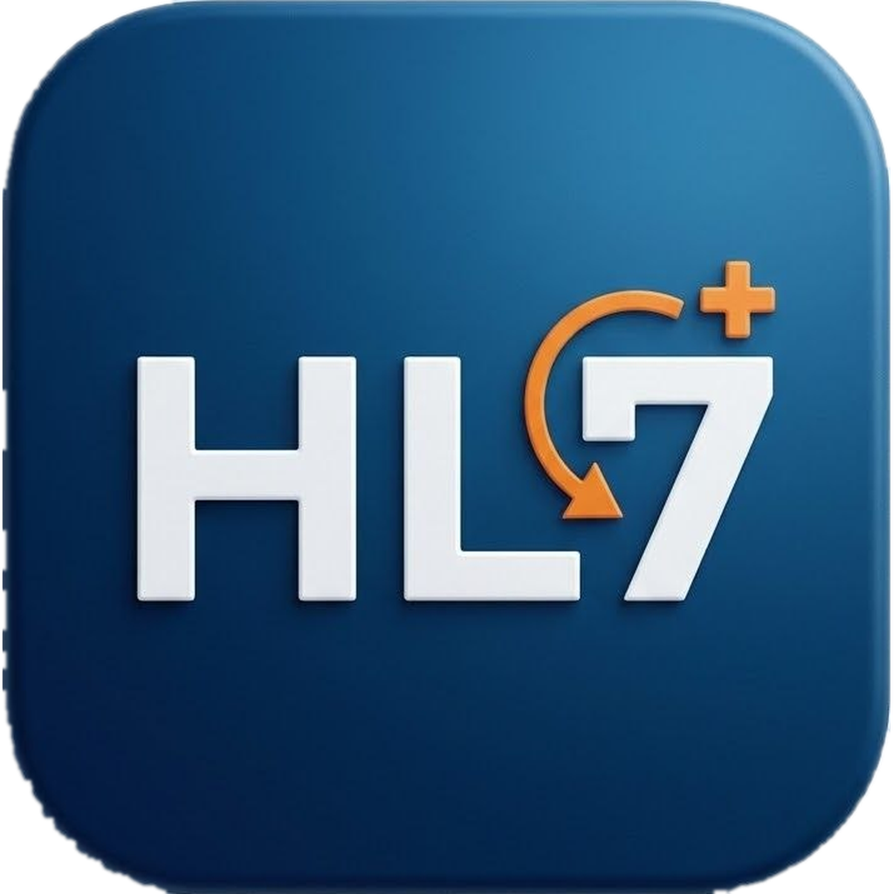

<p align="center">
  
</p>

<h1 align="center">MsgLab</h1>

<p align="center">
  Generate, validate and explain HL7 v2 messages for testing.<br>
  Windows, macOS and Linux.
</p>

> **Beta.** MsgLab is still in beta.
> Expect rough edges, and please [report problems](https://github.com/vads-cmd/MsgLab/issues) you find.

## Features

- **Editor** with line numbers. Paste or type a message, and see validation results and a plain-language explanation of every segment and field.
- **Generate** a single message: ADT A01, A02, A03, A08, A18, A40, A60, ORM O01, ORU R01 and ACK, for HL7 versions 2.3 to 2.8. Sending and receiving facilities are configurable.
- **Bulk generation** of many related messages (for example complete patient journeys) to fill an empty test database.
- **Files**: open and save messages, export bulk results as files, with CR, LF or CRLF line endings and an optional FHS/BHS batch wrapper. Wrapped and unwrapped files can both be imported.
- **Sending over MLLP** to a test server, with the ACK shown and checked (AA/CA accepted, AE/CE error, AR/CR rejected, control ID compared):
  - **Single message**: connect, send, wait for the ACK with a timeout, disconnect.
  - **Bulk**: send the messages of the Bulk tab on one connection, with a pace (default one per minute), an optional stop at the first message that is not accepted, a progress bar, a results table and a CSV report. The connection is opened again if the server closes it.
  - **Test connection** and saved connections (name, host, port, timeouts, encoding). Plain TCP only for now, no TLS.
- **Settings**: light, dark or system theme, default folders for saving and exporting, favorite message types.

## Download and install

Get the installer for your system from the [Releases](https://github.com/vads-cmd/MsgLab/releases) page.

| System | File | Notes |
|---|---|---|
| 🍎 macOS (Apple Silicon and Intel) | `MsgLab-<version>-arm64.dmg` / `MsgLab-<version>.dmg` | Drag MsgLab to Applications. See the macOS note below. |
| 🪟 Windows 10/11 (64-bit) | `MsgLab-Setup-<version>.exe` | See the Windows note below. |
| 🐧 Linux, any distribution | `MsgLab-<version>.AppImage` | `chmod +x` the file and run it. On Ubuntu 22.04 and later you may need `libfuse2`. |
| 🐧 Debian, Ubuntu | `msglab_<version>_amd64.deb` | `sudo apt install ./msglab_<version>_amd64.deb` |
| 🐧 Fedora, RHEL, CentOS, openSUSE | `msglab-<version>.x86_64.rpm` | `sudo dnf install ./msglab-<version>.x86_64.rpm` |

### 🍎 macOS: opening an unsigned app

MsgLab is not signed with an Apple Developer certificate yet, so macOS warns the first time you open it.

1. Open the `.dmg` and drag MsgLab to Applications.
2. Try to open it. When macOS says it cannot verify the app, click **Done**.
3. Open **System Settings → Privacy & Security**, scroll down and click **Open Anyway** next to MsgLab. Confirm with your password.

Alternatively, run this once in Terminal and open the app normally:

```
xattr -cr /Applications/MsgLab.app
```

### 🪟 Windows: SmartScreen

The installer is not signed yet either. If Windows shows "Windows protected your PC", click **More info → Run anyway**.

## Build from source

You need [Node.js](https://nodejs.org) 22 LTS or newer and Git.

```
git clone https://github.com/vads-cmd/MsgLab.git
cd MsgLab
npm install
npm start
```

| Command | What it does |
|---|---|
| `npm test` | Unit tests |
| `npm run test:e2e` | End-to-end tests (Playwright, Allure results) |
| `npm run test:all` | Both |
| `npm run pack` | Unpacked app in `dist/` for a quick check |
| `npm run dist:mac` / `dist:win` / `dist:linux` | Installers for one system (build on that system) |

Packaging notes and the release routine are in [doc/RELEASING.md](doc/RELEASING.md). The test strategy is in [doc/TEST_PLAN.md](doc/TEST_PLAN.md).

## License

[MIT](LICENSE) © Vadym "Ailur" Shevchenko
